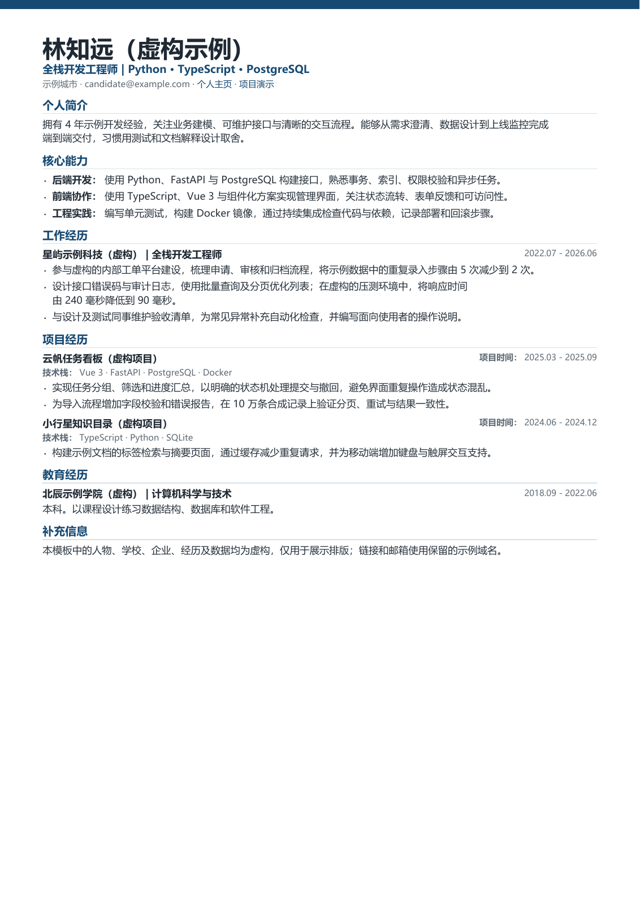

# Markdown 简历 PDF 模板

将中文或中英文混排的 Markdown 简历生成 A4 单页 PDF。换行先按实际字体测量，再交给 ReportLab 绘制，保留加粗和可点击链接。

示例中的人物、学校、企业、经历和指标全部虚构，邮箱及链接使用保留的示例域名。项目不包含真实个人简历、私人笔记、字体文件或外部笔记库路径。



[查看示例 PDF](examples/sample-resume.pdf) · [换行规范](docs/line-breaking.md) · [MIT 许可证](LICENSE)

## 快速开始

需要 Python 3.10 或更新版本。

```sh
python -m venv .venv
# Windows: .venv\Scripts\activate
# macOS / Linux: source .venv/bin/activate
python -m pip install -r requirements.txt
python resume_pdf.py
```

默认读取 `examples/resume.md`，输出 `output/pdf/resume.pdf`。默认路径相对于脚本定位，从其他目录运行也能使用；命令行传入的相对路径以当前工作目录为准。

Windows 也可双击 `generate-resume.cmd`。它会在本项目的 `.venv` 中检查并安装固定版本依赖，首次安装需要联网。自动调用时使用 `generate-resume.cmd -NoPause`。

## 写自己的简历

将文件放进默认忽略的 `private/` 目录，再执行：

```sh
python resume_pdf.py private/resume.md --output output/pdf/my-resume.pdf
```

Windows 启动器支持 `-Source private/resume.md -Output output/pdf/my-resume.pdf`。请自行创建并编辑输入文件；不会自动把示例复制成个人资料。

输入格式如下，完整示例见 `examples/resume.md`：

```markdown
# 示例姓名
**申请职位 | 技术方向**
candidate@example.com
[作品集](https://example.com)

## 工作经历
### 示例企业（虚构）｜示例职位
**2023.01 - 2025.12**
- 描述职责、行动与可解释的成果。
```

每个内容行是一个段落。长段落按排版宽度自动换行；缩进续行会合并到前一行。它采用明确的简历格式子集，具体行为见换行规范。

## 配置换行

编辑 `linebreak-rules.json` 的 `keep_together` 可添加希望整段保留的术语，`units` 可扩充数字单位。标点集合、宽度余量与末行长度目标同样可配置。

```sh
python resume_pdf.py --rules linebreak-rules.json --manifest tmp/layout.json
```

默认不会输出布局 JSON。可选的 manifest 包含完整段落及逐行文字，仅记录输入和输出的文件名，不记录绝对路径；请把它当作简历正文保管。`output/`、`tmp/`、`private/`、虚拟环境和字体文件默认由 Git 忽略。

## 字体与一致性

Windows 自动使用系统中的 Microsoft YaHei；Linux 自动检测 WenQuanYi Zen Hei。没有可用的系统字体时，退回到 PDF 的 `STSong-Light` CID 字体，此时由阅读器提供字形，粗体效果与外观可能不同。项目不附带任何字体。

可传入有使用许可的 TrueType 字体或使用 TrueType 轮廓的 TTC（索引 0）：

```sh
python resume_pdf.py --font /path/to/regular.ttf --bold-font /path/to/bold.ttf
```

不支持 CFF/PostScript 轮廓的 OTF。相同 Markdown、规则、依赖和字体会生成相同的 PDF；不同系统的默认字体可能使换行位置变化。示例 PDF 使用 Microsoft YaHei 生成，字体嵌入 PDF，字体原文件不随仓库分发。

## 验证

```sh
python -m pip install -r requirements-dev.txt
python -m unittest discover -s tests -v
```

测试覆盖混排原子单元、标点、末行调整、空格保留、跨格式术语、链接、异常配置、单页边界、溢出保护和 PDF 元数据。GitHub Actions 在 Windows / Ubuntu 以及 Python 3.10 / 3.12 上执行同一组测试，并生成虚构样例作为工作流产物。

字体及段落行为可查阅 [ReportLab 字体文档](https://docs.reportlab.com/reportlab/userguide/ch3_fonts/) 和 [段落文档](https://docs.reportlab.com/reportlab/userguide/ch6_paragraphs/)。本项目的具体规则以[换行规范 v1](docs/line-breaking.md)为准。
